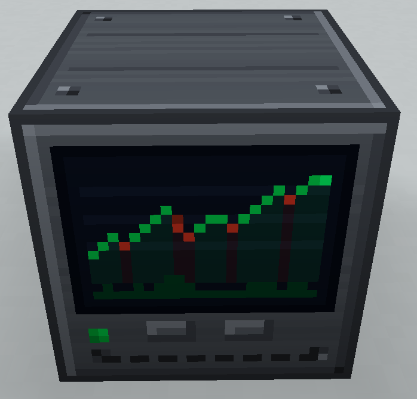
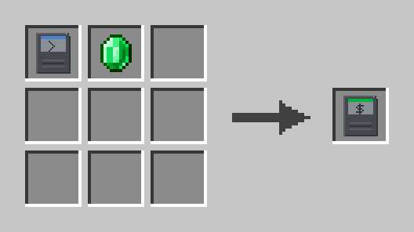
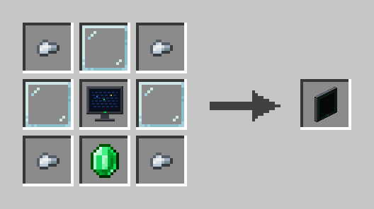
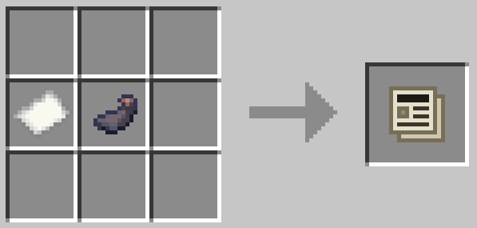

# Blöcke und Rezepte { #blocks-and-recipes }

StockMarket fügt zwei Blöcke und zwei Items hinzu. Einige Rezepte nutzen Teile aus BankSystem: den **Terminal Block**, die **Leere Software** und den **Bildschirm**. Ihre Rezepte findest du auf der [Rezeptseite von BankSystem](../banksystem/blocks-and-recipes.md).

| Block oder Item | Was es tut |
|---|---|
| **Aktienmarkt-Block** | Öffnet den Handelsbildschirm. |
| **Handels Software** | Macht aus einem Terminal Block einen Aktienmarkt-Block. |
| **Aktienmarkt-Anzeige** | Zeigt einen Live-Preischart an einer Wand. |
| **Zeitung** | Öffnet die Marktnachrichten. |

## Aktienmarkt-Block { #stock-market-block }

<figure markdown="span">
  { width="100" }
</figure>

Klicke ihn mit Rechts an, um den Handelsbildschirm zu öffnen. Siehe [Grundlagen des Handels](trading.md).

Diesen Block stellst du nicht direkt her:

1. Platziere einen **Terminal Block** aus BankSystem.
2. Halte eine **Handels Software** in der Hand und klicke mit Rechts auf den Terminal Block.

Der Terminal Block wird zu einem Aktienmarkt-Block. Die Software wird nicht verbraucht. Wenn du den Block abbaust, droppt er als Aktienmarkt-Block, sodass du ihn woanders platzieren kannst.

## Handels Software { #trading-software }

Eine **Leere Software** und ein **Smaragd** nebeneinander.

<figure markdown="span">
  { width="350" }
</figure>

## Aktienmarkt-Anzeige { #stock-market-display }

Vier **Eisenklumpen** in den Ecken, drei **Glasscheiben** oben, links und rechts, ein **Bildschirm** aus BankSystem in der Mitte und ein **Smaragd** unten.

<figure markdown="span">
  { width="350" }
</figure>

Wie du aus mehreren Anzeigen eine große Anzeige baust: [Aktienmarkt-Anzeige](display-block.md).

## Zeitung { #newspaper }

Ein **Papier** und ein **Tintenbeutel**, an beliebiger Stelle im Handwerksfeld. Du brauchst nur eine: Die Zeitung wird nie verbraucht.

<figure markdown="span">
  { width="350" }
</figure>

So liest du sie: [Marktnachrichten](newspaper.md).

## Verwandte Seiten { #related-pages }

- [BankSystem: Blöcke und Rezepte](../banksystem/blocks-and-recipes.md): der Terminal Block, die Leere Software und der Bildschirm.
- [Erste Schritte](../getting-started.md): dein erstes Bank Terminal und deinen ersten Aktienmarkt-Block bauen.
- [So arbeiten die beiden Mods zusammen](../together.md): die Familie des Terminal Blocks.
