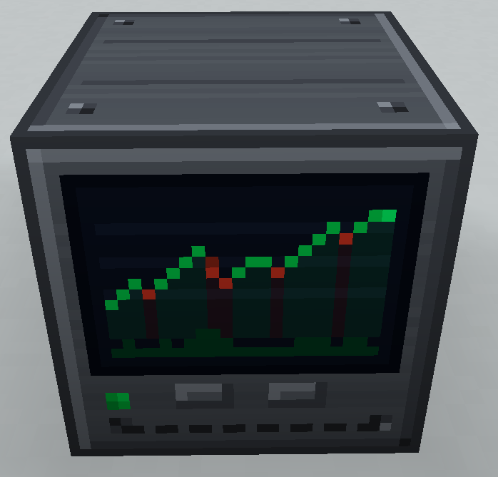
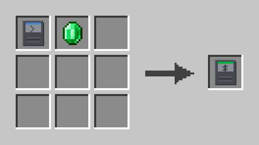
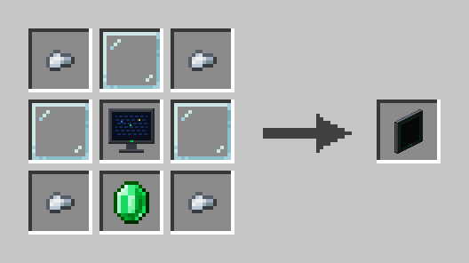
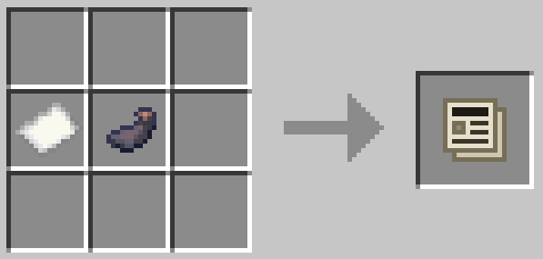

# Blocks and recipes

StockMarket adds two blocks and two items. Some recipes use parts from BankSystem: the **Terminal Block**, the **Empty Software** and the **Display**. You find their recipes on the [BankSystem recipe page](../banksystem/blocks-and-recipes.md).

| Block or item | What it does |
|---|---|
| **Stock Market Block** | Opens the trading screen. |
| **Trading Software** | Turns a Terminal Block into a Stock Market Block. |
| **Stock Market Display** | Shows a live price chart on a wall. |
| **Newspaper** | Opens the market news. |

## Stock Market Block

<figure markdown="span">
  { width="100" }
</figure>

Right-click it to open the trading screen. See [Trading basics](trading.md).

You don't craft this block directly:

1. Place a BankSystem **Terminal Block**.
2. Hold a **Trading Software** and right-click the Terminal Block.

The Terminal Block turns into a Stock Market Block. The software is not used up. When you break the block, it drops as a Stock Market Block, so you can place it somewhere else.

## Trading Software

One **Empty Software** and one **Emerald**, side by side.

<figure markdown="span">
  { width="350" }
</figure>

## Stock Market Display

Four **Iron Nuggets** in the corners, three **Glass Panes** at the top, left and right, a BankSystem **Display** in the middle and an **Emerald** at the bottom.

<figure markdown="span">
  { width="350" }
</figure>

How to build a screen from several displays: [Stock Market Display](display-block.md).

## Newspaper

One **Paper** and one **Ink Sac**, anywhere in the crafting grid. You only need one: the Newspaper is never used up.

<figure markdown="span">
  { width="350" }
</figure>

How to read it: [Market news](newspaper.md).

## Related pages

- [BankSystem blocks and recipes](../banksystem/blocks-and-recipes.md): the Terminal Block, Empty Software and Display.
- [Getting started](../getting-started.md): building your first Bank Terminal and Stock Market Block.
- [How the two mods work together](../together.md): the Terminal Block family.
