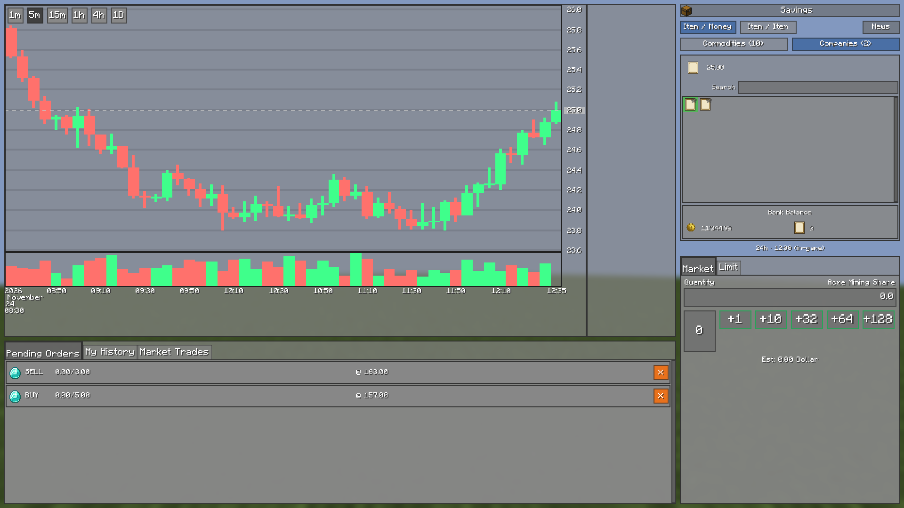

# Unternehmensaktien handeln { #trading-company-shares }

Spieler können in BankSystem Unternehmen gründen und deren Aktien prägen. Wenn ein Unternehmen einen Markt für seine Aktien eröffnet, kaufst und verkaufst du sie am Aktienmarkt wie jedes andere Item. Diese Seite zeigt, wo du Unternehmensmärkte findest und was dir der Besitz einer Aktie bringt.

## Unternehmensmärkte finden { #finding-company-markets }

1. Öffne den Handelsbildschirm an einem **Aktienmarkt-Block**.
2. Klicke in der oberen Leiste auf **Markt auswählen**. Im Modus **Item / Item** klickst du auf **Wählen...** neben **ICH HABE:** oder **ICH WILL:**.
3. Öffne den Tab **Unternehmen**. Normale Items findest du im Tab **Rohstoffe**.

Ein Unternehmen kann seiner Aktie ein eigenes Kartendesign geben (siehe [Die Aktie gestalten](../banksystem/shares.md#designing-the-share)), damit du die Unternehmen auseinanderhalten kannst. Eine Aktie ohne Design zeigt eine schlichte Karte. **Sortierung: Angebot** stellt die Unternehmen nach vorn, die den größten Teil ihrer Aktien geprägt haben.

<figure markdown="span">
  { width="600" }
</figure>

## Aktien kaufen und verkaufen { #buying-and-selling-shares }

Aktien werden genau wie andere Items gehandelt. Lies [Grundlagen des Handels](trading.md) für Market- und Limit-Orders.

- **Gekaufte Aktien** landen als Items **Unternehmensaktie** auf deinem Bankkonto.
- **Um Aktien zu verkaufen**, die du als Items besitzt, zahle sie zuerst an einem [Bank Terminal](../banksystem/bank-terminal.md) in die Bank ein.
- Das **Angebot** eines Unternehmens ist die Zahl der Aktien, die es geprägt hat, verglichen mit der Höchstzahl, die es prägen darf.

## Dividenden { #dividends }

Ein Unternehmen kann eine **Dividende** zahlen: einen Geldbetrag oder eine Menge eines Items pro Aktie. Jeder Aktionär bekommt *Aktien × Betrag pro Aktie*.

!!! note "Behalte deine Aktien in der Bank"
    Nur Aktien auf einem Bankkonto zählen für Dividenden, auch Aktien, die in einer offenen Verkaufsorder reserviert sind. Aktien in deinem Inventar oder in einer Truhe bekommen nichts.

Die Dividende geht auf das Bankkonto, das die Aktien hält. Wie ein Unternehmen sie auszahlt, steht unter [Auszahlungen und Dividenden](../banksystem/payouts.md).

## Pausierte und geschlossene Unternehmensmärkte { #paused-and-closed-company-markets }

Die Verwalter des Unternehmens können seinen Markt pausieren. Der Gründer kann ihn endgültig schließen.

- **Pausiert:** Der Handelsbildschirm zeigt ein rotes Banner, meist **In Wartung**, und du kannst nicht handeln. Deine offenen Orders auf diesem Markt werden sofort storniert und erstattet. Wenn das Unternehmen den Handel fortsetzt, startet der Markt mit einem leeren Orderbuch.
- **Pausiert wegen doppelter Aktien:** Das Banner zeigt *Geschlossen: Aktienduplikation erkannt (mehr Aktien eingelagert als gestempelt)*. In den Banken sind mehr Aktien aufgetaucht, als das Unternehmen je geprägt hat. Ein Firmen-Admin muss das prüfen und den Markt wieder öffnen.
- **Endgültig geschlossen:** Der Markt ist weg, mitsamt seinem Preisverlauf. Deine Aktien bleiben auf deinem Bankkonto und in deinem Inventar. Du kannst sie weiter besitzen und direkt mit anderen Spielern handeln.

## Verwandte Seiten { #related-pages }

- [Dein Unternehmen am Aktienmarkt](../banksystem/company-market.md): wie ein Unternehmen seinen Markt eröffnet, pausiert und schließt.
- [Aktien und die Aktien-Prägestation](../banksystem/shares.md): wie Aktien geprägt werden.
- [Grundlagen des Handels](trading.md): Orders platzieren.
