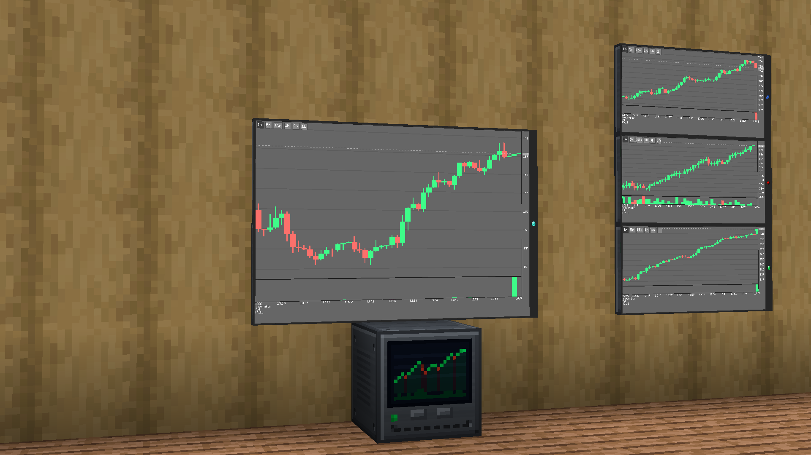
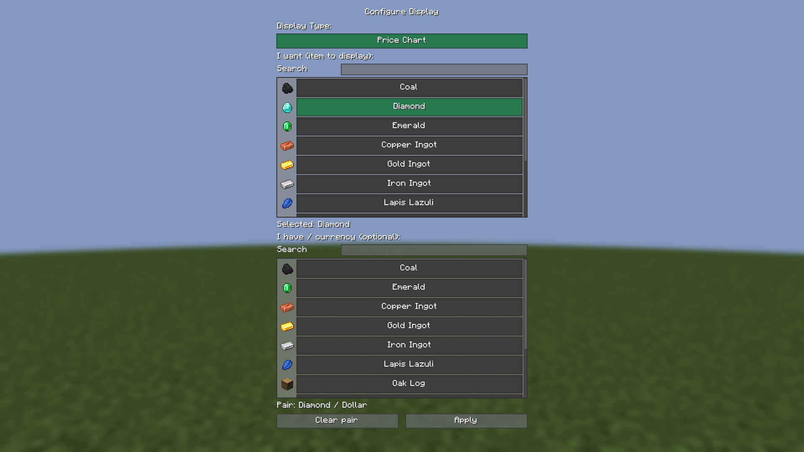

# Aktienmarkt-Anzeige { #stock-market-display }

Die **Aktienmarkt-Anzeige** zeigt den Live-Preischart eines Marktes an einer Wand. Mehrere Anzeigen nebeneinander, die denselben Markt zeigen, verbinden sich zu einem großen Bildschirm. Du kannst einen normalen Markt zeigen oder den Kurs zwischen zwei Items.

<figure markdown="span">
  { width="600" }
</figure>

## Bevor du anfängst { #before-you-start }

- Du hast eine oder mehrere **Aktienmarkt-Anzeigen**. Das Rezept steht unter [Blöcke und Rezepte](blocks-and-recipes.md).
- Der Markt, den du zeigen willst, existiert auf deinem Server.

## Einen Bildschirm bauen { #building-a-screen }

1. Platziere die Anzeigen an einer Wand, nebeneinander und übereinander.
2. Achte darauf, dass alle in dieselbe Richtung zeigen. Anzeigen, die in dieselbe Richtung zeigen, sich berühren und denselben Markt zeigen, verbinden sich zu einem Bildschirm. Neue Anzeigen sind noch nicht eingerichtet und verbinden sich deshalb miteinander: Platziere zuerst den ganzen Bildschirm und richte ihn dann ein.
3. Fülle ein vollständiges Rechteck, zum Beispiel 3 breit und 2 hoch. Der Bildschirm umfasst das größte Rechteck, das bei der Anzeige oben links beginnt.

Ein neuer Bildschirm zeigt *Rechtsklick zum Konfigurieren*.

## Wählen, was er zeigt { #choosing-what-it-shows }

1. Klicke mit Rechts auf den Bildschirm. Das Fenster **Anzeige konfigurieren** öffnet sich.
2. Wähle unter **Ich will (anzuzeigendes Item):** den Markt, der angezeigt werden soll.
3. Optional: Wähle unter **Ich habe / Währung (optional):** ein zweites Item. Der Bildschirm zeigt dann den Kurs zwischen den beiden Items, wie im [Modus Item / Item](pair-trading.md). **Paar entfernen** wechselt zurück zu einem normalen Preischart.
4. Klicke auf **Anwenden**.

<figure markdown="span">
  { width="600" }
</figure>

## Genauer hinsehen { #looking-closer }

Sobald der Bildschirm einen Chart zeigt, klicke ihn mit Rechts an, um den Chart im Vollbild zu öffnen. Verschiebe und zoome ihn wie im Handelsbildschirm, siehe [Im Chart bewegen](price-chart.md#moving-around-the-chart). Wenn du den Vollbild-Chart schließt, behält der Wandbildschirm die Ansicht, die du gewählt hast.

## Einen anderen Markt zeigen { #showing-a-different-market }

!!! warning "Du musst den Bildschirm neu bauen"
    Nachdem du auf **Anwenden** geklickt hast, öffnet ein Rechtsklick immer den Chart, nicht die Einstellungen. Um einen anderen Markt zu zeigen, baue alle Anzeigen des Bildschirms ab und platziere sie neu. Der Bildschirm behält seine Einstellungen, solange noch eine seiner Anzeigen steht.

## Verwandte Seiten { #related-pages }

- [Preischart und Orderbuch](price-chart.md): den Chart lesen.
- [Item gegen Item handeln](pair-trading.md): was der Kurs bedeutet.
- [Blöcke und Rezepte](blocks-and-recipes.md): die Anzeige herstellen.
