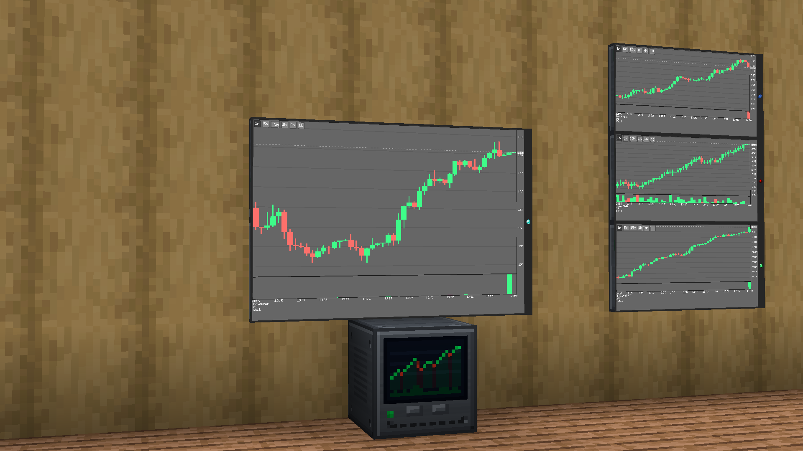

# StockMarket { #stockmarket }

StockMarket fügt deinem Server einen Aktienmarkt hinzu. Jedes Item kann einen eigenen Markt haben, auf dem Spieler es für Geld kaufen und verkaufen. Die Preise sind nicht fest: Sie entstehen aus den Orders von Spielern und Markt-Bots und bewegen sich mit jedem Handel.

StockMarket nutzt dein [BankSystem-Bankkonto](../banksystem/bank-accounts.md) als Geldbörse. Neu bei beiden Mods? Fang mit [Erste Schritte](../getting-started.md) an.

<figure markdown="span">
  { width="600" }
</figure>

## Was du tun kannst { #what-you-can-do }

| Ich möchte | Lies |
|---|---|
| Items für Geld kaufen und verkaufen | [Grundlagen des Handels](trading.md) |
| Den Chart verstehen und warum sich Preise bewegen | [Preischart und Orderbuch](price-chart.md) |
| Ein Item direkt gegen ein anderes tauschen | [Item gegen Item handeln](pair-trading.md) |
| Aktien des Unternehmens eines Spielers kaufen | [Unternehmensaktien handeln](company-shares.md) |
| Die News lesen, die Preise bewegen | [Marktnachrichten](newspaper.md) |
| Mit Dorfbewohnern für Geld handeln | [Dorfbewohner-Handel](villager-trading.md) |
| Einen Live-Preischart an eine Wand hängen | [Aktienmarkt-Anzeige](display-block.md) |
| Die Blöcke und Items herstellen | [Blöcke und Rezepte](blocks-and-recipes.md) |

## Gut zu wissen { #good-to-know }

- **Nur Items mit einem Markt können gehandelt werden.** Dein Server-Admin erstellt die Märkte.
- **Es gibt keine Gebühren.** Du zahlst den Marktpreis, nichts obendrauf.
- **Märkte können auch ohne dich in Bewegung sein.** Auf den meisten Servern handeln auch Markt-Bots, also bewegen sich die Preise, selbst wenn kein anderer Spieler online ist.
- **Manche Märkte haben Öffnungszeiten.** Siehe [Wenn ein Markt geschlossen ist](trading.md#when-a-market-is-closed).

## Verwandte Seiten { #related-pages }

- [Erste Schritte](../getting-started.md): deine erste Einzahlung und dein erster Handel.
- [So arbeiten die beiden Mods zusammen](../together.md): die Bank und der Markt in einem Bild.
- [Glossar](../glossary.md): Marktbegriffe erklärt.
