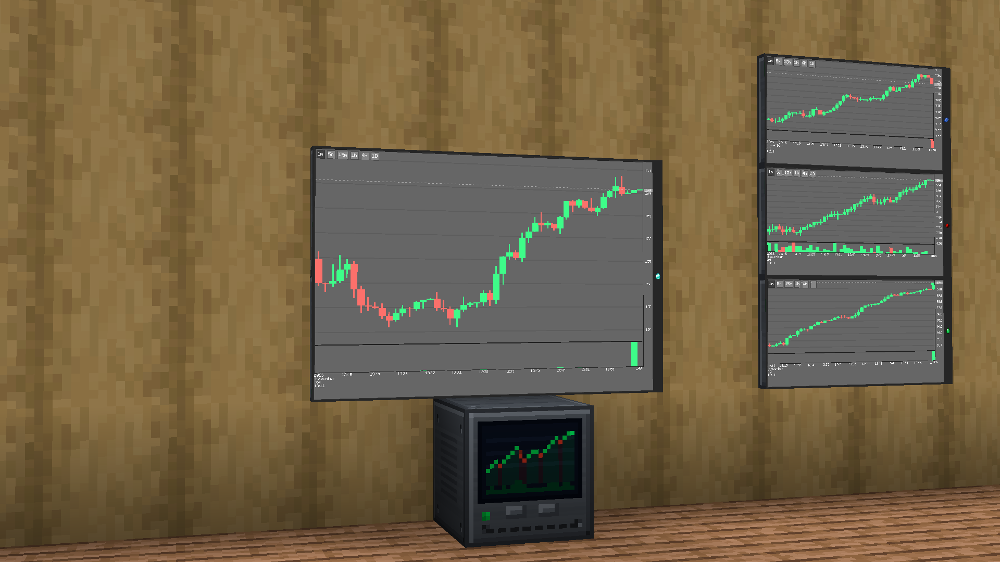

# StockMarket

StockMarket adds a stock market to your server. Every item can have its own market, where players buy and sell it for money. Prices are not fixed: they come from the orders of players and of market bots, and they move with every trade.

StockMarket uses your [BankSystem bank account](../banksystem/bank-accounts.md) as its wallet. New to both mods? Start with [Getting started](../getting-started.md).

<figure markdown="span">
  { width="600" }
</figure>

## What you can do

| I want to | Read |
|---|---|
| Buy and sell items for money | [Trading basics](trading.md) |
| Understand the chart and why prices move | [Price chart and order book](price-chart.md) |
| Swap one item straight for another | [Trading item for item](pair-trading.md) |
| Buy shares of a player's company | [Trading company shares](company-shares.md) |
| Read the news that moves prices | [Market news](newspaper.md) |
| Trade with villagers for money | [Villager trading](villager-trading.md) |
| Put a live price chart on a wall | [Stock Market Display](display-block.md) |
| Craft the blocks and items | [Blocks and recipes](blocks-and-recipes.md) |

## Good to know

- **Only items with a market can be traded.** Your server admin creates the markets.
- **There are no fees.** You pay the market price, nothing on top.
- **Markets can be busy without you.** On most servers, market bots trade too, so prices move even when no other player is online.
- **Some markets have opening hours.** See [When a market is closed](trading.md#when-a-market-is-closed).

## Related pages

- [Getting started](../getting-started.md): your first deposit and your first trade.
- [How the two mods work together](../together.md): the bank and the market in one picture.
- [Glossary](../glossary.md): market words explained.
