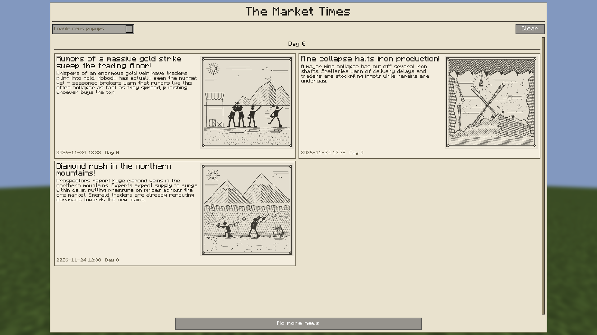
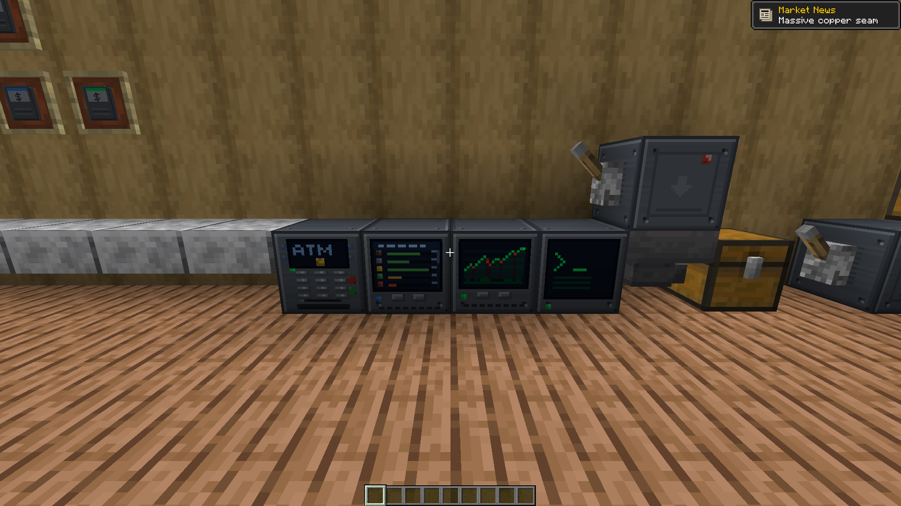

# Marktnachrichten { #market-news }

Von Zeit zu Zeit veröffentlicht der Server Marktnachrichten: einen Goldrausch, eine schlechte Ernte, eine neue Handelsroute. So eine Meldung drückt den Preis einiger Items eine Zeit lang nach oben oder unten. Du liest die News in **The Market Times**, der Zeitung im Spiel.

## Die Zeitung öffnen { #opening-the-newspaper }

Du hast drei Möglichkeiten:

- **Das Item Zeitung.** Klicke damit in der Hand mit Rechts. Es funktioniert überall und wird nie verbraucht.
- **Der Knopf News** in der oberen Leiste des Handelsbildschirms.
- **Der Befehl** unten. Jeder Spieler kann ihn benutzen.

```text
/stockmarket news
```

Um eine Zeitung herzustellen, lege ein **Papier** und einen **Tintenbeutel** an eine beliebige Stelle im Handwerksfeld.

## Die News lesen { #reading-the-news }

<figure markdown="span">
  { width="600" }
</figure>

Die neuesten Meldungen stehen oben, nach Spieltag gruppiert. Jede Meldung hat eine Schlagzeile, einen kurzen Artikel und manchmal ein Bild. Darunter siehst du, wann sie erschienen ist: dein lokales Datum mit Uhrzeit und den Spieltag.

- **Mehr laden** ganz unten lädt ältere Meldungen.
- **Leeren** blendet alle Meldungen aus, die du gerade siehst, nur für dich. Andere Spieler sehen sie weiter, und neue Meldungen erscheinen wie gewohnt.

Die Schlagzeilen sind in deiner Spielsprache, wenn der Server eine Übersetzung dafür hat. Sonst sind sie auf Englisch.

!!! note "Die Zeitung verrät dir die Wirkung nicht"
    Eine Meldung sagt nicht, welche Märkte sie bewegt oder in welche Richtung. Du musst sie lesen und das selbst herausfinden, wie ein echter Händler.

## News-Popups { #news-popups }

Standardmäßig erscheint nichts: Du siehst News nur, wenn du die Zeitung öffnest. Um für jede neue Meldung ein kleines Popup oben rechts zu bekommen, setze in der Zeitung den Haken bei **News-Popups aktivieren**. Der Server merkt sich deine Wahl.

<figure markdown="span">
  { width="350" }
</figure>

Mit eingeschalteten Popups holst du beim Betreten des Servers auch Verpasstes nach: Du siehst bis zu drei Meldungen aus den letzten zehn Minuten.

## Wie News die Preise bewegen { #how-news-moves-prices }

Eine Meldung ändert den Preis eines oder mehrerer Items Schritt für Schritt. Eine typische Meldung:

1. **Baut sich auf.** Nachdem die Meldung erschienen ist, beginnt der Preis sich zu bewegen und bewegt sich eine Weile weiter.
2. **Hält.** Der Preis bleibt auf dem neuen Niveau.
3. **Klingt ab.** Der Preis geht zurück in Richtung seines alten Werts.

Manche Meldungen ändern einen Preis dauerhaft und klingen nie ab. Wie stark und wie lange jede Meldung wirkt, legt der Server-Admin fest. Nur Märkte, auf denen der Admin News eingeschaltet hat, reagieren darauf.

Spieler handeln auch während einer Meldung weiter. Ein Ansturm von Käufern kann einen Preis weiter treiben als die Meldung allein, und Verkäufer können ihn bremsen.

## Verwandte Seiten { #related-pages }

- [Preischart und Orderbuch](price-chart.md): die Wirkung einer Meldung im Chart beobachten.
- [Grundlagen des Handels](trading.md): Orders platzieren.
- [Blöcke und Rezepte](blocks-and-recipes.md): das Rezept der Zeitung.
