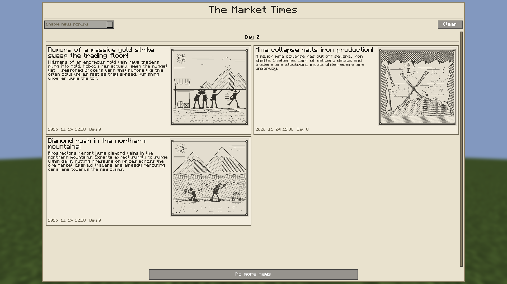
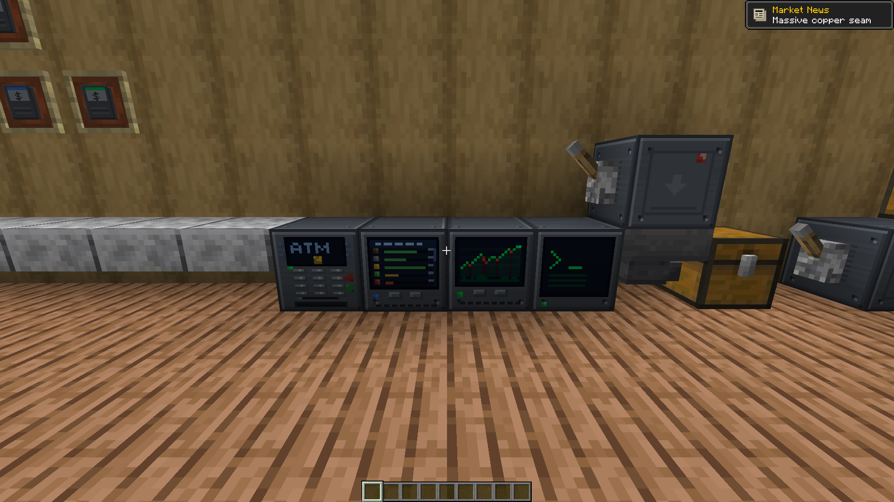

# Market news

From time to time the server publishes market news: a gold rush, a bad harvest, a new trade route. A story like this pushes the price of some items up or down for a while. You read the news in **The Market Times**, the in-game newspaper.

## Opening the newspaper

You have three ways:

- **The Newspaper item.** Right-click with it in your hand. It works anywhere, and it is never used up.
- **The News button** in the top bar of the trading screen.
- **The command** below. Every player can use it.

```text
/stockmarket news
```

To craft a Newspaper, put one **Paper** and one **Ink Sac** anywhere in a crafting grid.

## Reading the news

<figure markdown="span">
  { width="600" }
</figure>

The newest stories are at the top, grouped by in-game day. Each story has a headline, a short article and sometimes a picture. Under it you see when it came out: your local date and time and the in-game day.

- **Load more** at the bottom loads older stories.
- **Clear** hides all stories you see right now, only for you. Other players still see them, and new stories show up as usual.

The headlines are in your game language if the server has a translation for it. Otherwise they are in English.

!!! note "The newspaper doesn't tell you the effect"
    A story doesn't say which markets it moves or in which direction. You have to read it and work that out yourself, like a real trader.

## News popups

By default nothing pops up: you only see news when you open the newspaper. To get a small popup in the top-right corner for each new story, tick **Enable news popups** in the newspaper. The server remembers your choice.

<figure markdown="span">
  { width="600" }
</figure>

With popups on, you also catch up when you join: you see up to three stories from the last ten minutes.

## How news moves prices

A news story changes the price of one or more items step by step. A typical story:

1. **Builds up.** After the story comes out, the price starts to move and keeps moving for a while.
2. **Holds.** The price stays at the new level.
3. **Fades.** The price goes back towards where it was.

Some stories change a price for good and never fade. How strong and how long each story works is set by the server admin. Only markets where the admin has turned news on react to it.

Players still trade during a story. A rush of buyers can push a price further than the story alone, and sellers can stop it.

## Related pages

- [Price chart and order book](price-chart.md): watch the effect of a story on the chart.
- [Trading basics](trading.md): placing orders.
- [Blocks and recipes](blocks-and-recipes.md): the Newspaper recipe.
