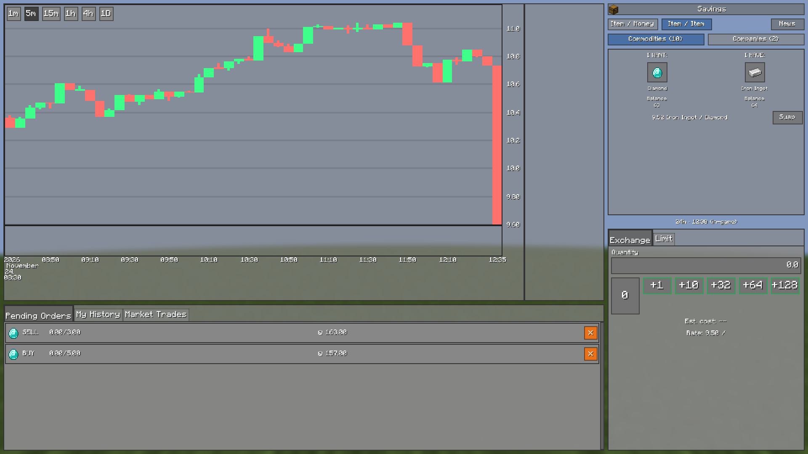

# Item gegen Item handeln { #trading-item-for-item }

Im Modus **Item / Item** tauschst du ein Item direkt gegen ein anderes, zum Beispiel Eisen gegen Diamanten. Dafür brauchst du kein Geld. Der Markt verkauft das Item, das du hast, und kauft das Item, das du willst, in einem Schritt. Diese Seite zeigt dir, wie das geht.

## Bevor du anfängst { #before-you-start }

- Beide Items brauchen auf deinem Server einen Markt.
- Das Item, mit dem du bezahlst, muss wie bei jedem Handel auf deinem [Bankkonto](../banksystem/bank-accounts.md) sein. Das Item, das du bekommst, landet auf demselben Konto.
- Du kennst die Grundlagen von [Market- und Limit-Orders](trading.md).

## Das Paar wählen { #choosing-the-pair }

1. Öffne den Handelsbildschirm an einem **Aktienmarkt-Block**.
2. Klicke in der oberen Leiste auf **Item / Item**.
3. Wähle neben **ICH HABE:** das Item, mit dem du bezahlst, zum Beispiel Eisen.
4. Wähle neben **ICH WILL:** das Item, das du bekommen willst, zum Beispiel Diamanten.

Jede Seite zeigt dein **Guthaben** an diesem Item. **Tauschen** dreht das Paar um. Wenn du ein Item auswählst, hat die Liste zwei Tabs: **Rohstoffe** für normale Items und **Unternehmen** für [Unternehmensaktien](company-shares.md).

<figure markdown="span">
  { width="600" }
</figure>

## Der Kurs { #the-exchange-rate }

Der **Kurs** gibt an, wie viele Items von ICH HABE ein Item von ICH WILL kostet. Zum Beispiel bedeutet *Kurs: 12.5 Eisenbarren/Diamant*, dass ein Diamant 12.5 Eisenbarren kostet.

Der Kurs ergibt sich aus den beiden Marktpreisen:

```text
rate = price of the I WANT item ÷ price of the I HAVE item
```

Der Kurs ändert sich also, sobald sich einer der beiden Preise bewegt. In diesem Modus zeigt der Chart den Kurs, keinen Preis in Geld.

## Tausch: jetzt tauschen { #exchange-swap-now }

Der Tab **Tausch** funktioniert wie eine Market-Order. Er handelt sofort zum aktuellen Kurs.

1. Gib eine **Menge** ein. Die Menge zählt immer Items von ICH WILL.
2. Prüfe **Gesch. Kosten**: ungefähr so viele Items von ICH HABE kostet der Tausch.
3. Klicke auf einen Knopf:
    - **Kaufen** bringt dir die Items von ICH WILL und bezahlt mit deinen Items von ICH HABE.
    - **Verkaufen** gibt Items von ICH WILL ab und bringt dir Items von ICH HABE.

Wie bei einer Market-Order kann ein großer Tausch auf beiden Märkten durch mehrere Preisstufen gehen. Der Kurs, den du bekommst, ist dann schlechter als der Kurs, den du gesehen hast.

## Limit: zu deinem Kurs tauschen { #limit-swap-at-your-rate }

Der Tab **Limit** funktioniert wie eine Limit-Order. Er handelt nur zu deinem Kurs oder einem besseren.

1. Gib das **Kurslimit** ein. Klicke auf **Markt**, um den aktuellen Kurs als Startwert einzutragen.
2. Gib eine **Menge** an Items von ICH WILL ein.
3. Klicke auf **Kauf-Limit** oder **Verkauf-Limit**.
    - **Kauf-Limit** zahlt höchstens deinen Kurs.
    - **Verkauf-Limit** bekommt mindestens deinen Kurs.

Die Order wartet, bis der Kurs dein Limit erreicht. Sie erscheint im Chart als Linie bei ihrem Kurs. Du kannst sie verschieben oder stornieren wie eine normale Limit-Order. Siehe [Deine Orders im Chart](price-chart.md#your-orders-on-the-chart).

## Gut zu wissen { #things-to-know }

- **Beide Märkte müssen geöffnet sein.** Ist einer davon [geschlossen](trading.md#when-a-market-is-closed), wartet deine Tauschorder, bis beide geöffnet sind.
- **Die max. Ordergröße jedes Marktes** und der **Handels-Cooldown** gelten wie bei normalen Orders.
- **Gesch. Kosten** wird rot, wenn du für einen Kauf nicht genug Items von ICH HABE hast.

## Verwandte Seiten { #related-pages }

- [Grundlagen des Handels](trading.md): dieselben Ordertypen mit Geld.
- [Preischart und Orderbuch](price-chart.md): warum sich die Preise und damit der Kurs bewegen.
- [Aktienmarkt-Anzeige](display-block.md): den Kurs eines Paars an einer Wand zeigen.
