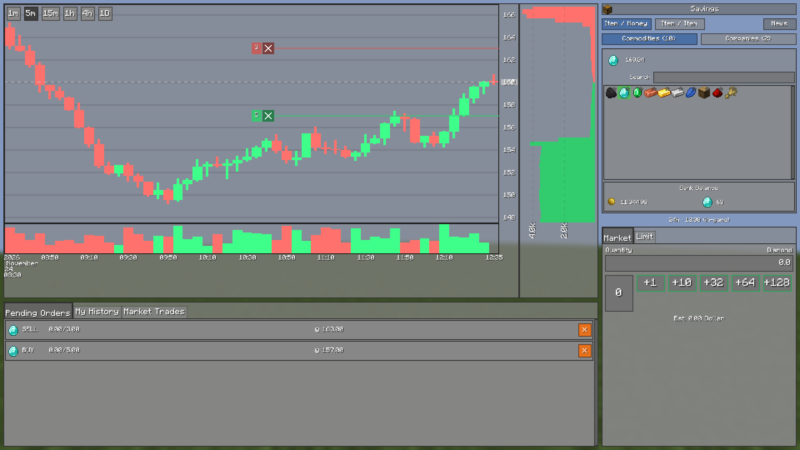
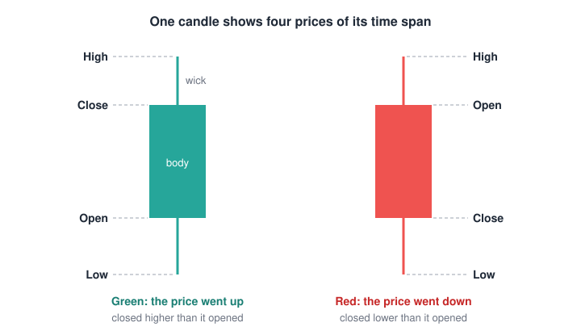

# Preischart und Orderbuch { #price-chart-and-order-book }

Die linke Hälfte des Handelsbildschirms zeigt den Preisverlauf des Marktes als Kerzenchart. An seinem rechten Rand siehst du das Orderbuch: wie viele Items zu jedem Preis darauf warten, gekauft oder verkauft zu werden. Diese Seite erklärt, wie du beides liest und warum sich der Preis bewegt.

<figure markdown="span">
  { width="600" }
</figure>

## Kerzen { #candles }

Jede Kerze deckt eine Zeitspanne ab. Sie zeigt vier Preise:

- **Eröffnung**: der Preis zu Beginn der Zeitspanne.
- **Schluss**: der Preis am Ende.
- **Hoch** und **Tief**: der höchste und der niedrigste Preis dazwischen. Die dünne Linie (der Docht) reicht vom Tief bis zum Hoch.

Eine **grüne** Kerze hat höher geschlossen, als sie eröffnet hat: Der Preis ist gestiegen. Eine **rote** Kerze hat tiefer geschlossen: Der Preis ist gefallen.

<figure markdown="span">
  { width="600" }
</figure>

Die kleinen Balken unter den Kerzen zeigen, wie viele Items in jeder Zeitspanne gehandelt wurden. Sie haben die Farbe ihrer Kerze.

Das Label am rechten Rand des Charts markiert den aktuellen Preis. Der aktuelle Preis ist immer der Preis des letzten Handels.

### Zeitrahmen { #timeframes }

Die Knöpfe am Chart legen fest, wie lang eine Kerze ist: **1m**, **5m**, **15m**, **1h**, **4h** oder **1d**. Kurze Zeitrahmen zeigen die letzten Minuten im Detail. Lange zeigen den Trend über Tage.

Manche Server messen Kerzen stattdessen in Spielzeit. Die Knöpfe sind dann **1h**, **4h**, **1D** und **1W**, gezählt in Spielstunden, und die Zeitachse zeigt den Spieltag.

## Im Chart bewegen { #moving-around-the-chart }

| Ziel | So geht's |
|---|---|
| Die Ansicht verschieben | Zieh den Chart mit der linken Maustaste. |
| Hinein- oder herauszoomen | Dreh das Mausrad über dem Chart. Es zoomt um den Mauszeiger herum. |
| Nur entlang der Zeitachse zoomen | Halte ++shift++ gedrückt und scrolle. |
| Nur entlang der Preisachse zoomen | Halte ++ctrl++ gedrückt und scrolle. |
| Die Preisachse an die sichtbaren Kerzen anpassen | Drück ++space++. |
| Zur neuesten Kerze springen | Drück ++ctrl+space++. |

Wenn du in der Zeit zurückgehst, lädt der Chart nach und nach ältere Kerzen.

## Das Orderbuch { #the-order-book }

Die Balken am rechten Rand des Charts zeigen das Orderbuch: die [Limit-Orders](trading.md#limit-order-trade-at-your-price), die darauf warten, ausgeführt zu werden. Jeder Balken steht bei einem Preis. Je länger der Balken, desto mehr Items warten zu diesem Preis.

- **Grüne Balken** unter dem aktuellen Preis sind Kauforders: Jemand will zu diesem Preis kaufen.
- **Rote Balken** über dem aktuellen Preis sind Verkaufsorders: Jemand will zu diesem Preis verkaufen.

Das Orderbuch verrät dir, was eine [Market-Order](trading.md#market-order-trade-now) kosten wird. Eine Market-Kauforder wird gegen die roten Balken ausgeführt, beginnend beim niedrigsten. Wenn die roten Balken nahe am Preis kurz sind, geht ein großer Kauf durch mehrere davon und zahlt immer mehr. Dasselbe gilt für einen Verkauf gegen die grünen Balken.

## Deine Orders im Chart { #your-orders-on-the-chart }

Jede deiner offenen Limit-Orders erscheint als waagerechte Linie bei ihrem Preis.

- **Zieh den Griff** an der Linie, um die Order auf einen neuen Preis zu verschieben. Eine Kauforder lässt sich nur nach oben schieben, wenn du genug Geld für den höheren Preis hast.
- **Klick auf das X** an der Linie, um die Order zu stornieren. Das reservierte Geld oder die reservierten Items gehen zurück auf dein Konto.

Deine Orders erscheinen auch im Tab **Offene Orders** des Handelspanels.

## Warum sich ein Preis bewegt { #why-a-price-moves }

Der Preis ändert sich nur, wenn ein Handel stattfindet. Jeder Handel setzt den Preis auf den Preis, zu dem er ausgeführt wurde. Also:

- **Eine Market-Kauforder** wird gegen die günstigsten Verkaufsorders ausgeführt. Wenn sie alle Items zu einem Preis aufgebraucht hat, findet der nächste Handel zu einem höheren Preis statt, und der Preis steigt.
- **Eine Market-Verkaufsorder** macht dasselbe nach unten, gegen die höchsten Kauforders.
- **Eine Limit-Order**, die über den aktuellen Preis hinausreicht, handelt sofort wie eine Market-Order, bis zu ihrem eigenen Preis. Der Rest wartet im Orderbuch.

Eine Limit-Order, die nur wartet, bewegt den Preis nicht. Sie verändert das Orderbuch, und das entscheidet, wie weit die nächste Market-Order den Preis bewegt.

Nicht nur Spieler handeln. Auf den meisten Servern fügen Markt-Plugins eigene Orders hinzu, also bewegen sich die Preise, auch wenn niemand online ist. [Marktnachrichten](newspaper.md) können einen Preis eine Zeit lang nach oben oder unten drücken.

!!! tip "Große Orders auf ruhigen Märkten"
    Wenn das Orderbuch neben dem Preis dünn ist, kann eine große Market-Order den Preis stark bewegen, und du zahlst mehr als den Preis, den du gesehen hast. Teile große Geschäfte auf oder nutze eine Limit-Order.

## Verwandte Seiten { #related-pages }

- [Grundlagen des Handels](trading.md): Market- und Limit-Orders platzieren.
- [Marktnachrichten](newspaper.md): News, die Preise bewegen.
- [Glossar](../glossary.md): Spread, Liquidität, Sweep und andere Marktbegriffe.
