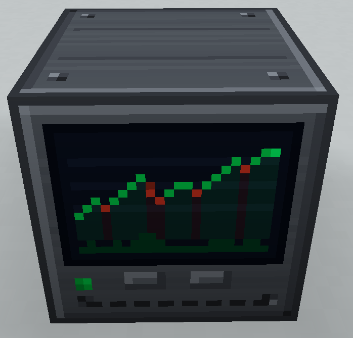
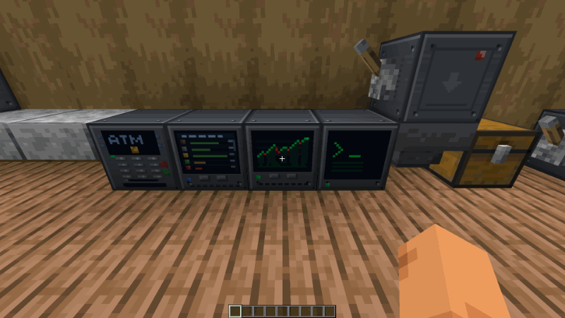
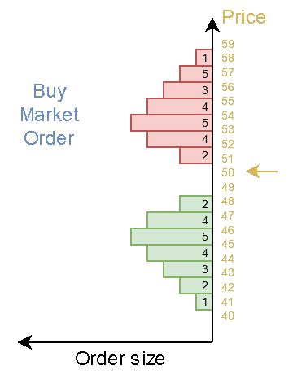
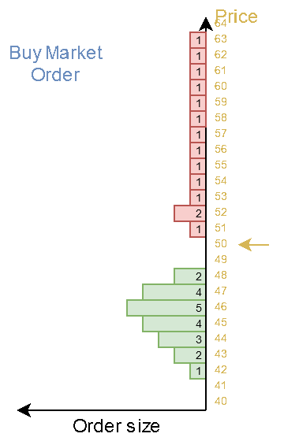
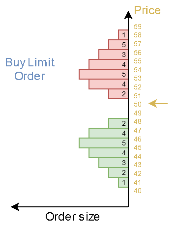
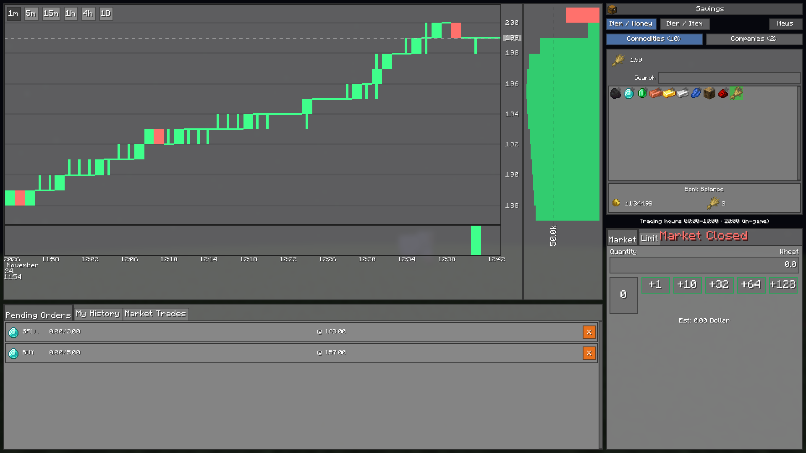

# Grundlagen des Handels { #trading-basics }

Am Aktienmarkt kaufst und verkaufst du Items für Geld. Du gibst Items nicht direkt einem anderen Spieler. Stattdessen platzierst du eine **Order**, und der Markt führt sie mit jemandem zusammen, der das Gegengeschäft machen will. Diese Seite zeigt dir, wie du deine ersten Orders platzierst und woher das Geld und die Items kommen.

## Bevor du anfängst { #before-you-start }

Du brauchst drei Dinge:

- **Einen Markt für das Item.** Nur Items mit einem Markt können gehandelt werden. Der Server-Admin erstellt die Märkte.
- **Ein Bankkonto.** StockMarket hat keine eigene Geldbörse. Jeder Handel nutzt das Geld und die Items auf deinem [BankSystem-Bankkonto](../banksystem/bank-accounts.md). Jeder Spieler bekommt automatisch ein persönliches Konto.
- **Einen Aktienmarkt-Block**, um den Handelsbildschirm zu öffnen. Um einen zu bauen, klicke einen **Terminal Block** aus BankSystem mit einer **Handels Software** mit Rechts an. Siehe [Blöcke und Rezepte](blocks-and-recipes.md).

<figure markdown="span">
  { width="100" }
</figure>

## Woher das Geld und die Items kommen { #where-the-money-and-items-come-from }

Alle Geschäfte laufen über dein Bankkonto:

- **Zum Kaufen** brauchst du Geld auf dem Konto. Wenn die Order ausgeführt wird, landen die Items auf demselben Konto.
- **Zum Verkaufen** müssen die Items zuerst auf dem Konto sein. Zahle sie an einem [Bank Terminal](../banksystem/bank-terminal.md) ein. Wenn die Order ausgeführt wird, landet das Geld auf dem Konto.
- Wenn du eine Order platzierst, **reserviert** der Markt, was sie braucht: das Geld für einen Kauf oder die Items für einen Verkauf. Reserviertes Geld und reservierte Items sind gesperrt, du kannst sie also nicht doppelt ausgeben. Wenn du die Order stornierst, werden sie wieder freigegeben.
- Um gekaufte Items in dein Inventar zu bekommen, hebe sie an einem Bank Terminal ab.

Du kannst mit jedem Konto handeln, auf dem du die Berechtigungen **Einzahlen** und **Abheben** hast, zum Beispiel mit einem gemeinsamen Konto mit Freunden. Klicke auf den Kontoknopf oben im Handelsbildschirm, um eines zu wählen. Konten, mit denen du nicht handeln kannst, sind ausgegraut. Der **Kontostand** in der oberen Leiste zeigt, was das gewählte Konto enthält.

!!! note "Eingefrorene Konten"
    Wenn ein Admin dein Bankkonto eingefroren hat, kannst du damit nicht handeln. Du bekommst die Meldung *„Dieses Bankkonto wurde von einem Admin gesperrt und kann nicht handeln“*. Seine offenen Orders wurden beim Einfrieren storniert, und ihr Geld und ihre Items sind wieder auf dem Konto.

## Der Handelsbildschirm { #the-trading-screen }

Klicke mit Rechts auf den Aktienmarkt-Block, um den Handelsbildschirm zu öffnen.

<figure markdown="span">
  { width="600" }
</figure>

Der Bildschirm hat drei Teile:

- **Die obere Leiste** enthält deine Lieblingsmärkte und die Kontoauswahl. Klicke auf einen Markt, um zu ihm zu wechseln, oder nutze **Markt auswählen**, um alle Märkte durchzusehen. Die beiden Modusknöpfe wechseln zwischen **Item / Geld** (für Geld kaufen und verkaufen) und **Item / Item** (ein Item gegen ein anderes tauschen, siehe [Item gegen Item handeln](pair-trading.md)). Der Knopf **News** öffnet die [Zeitung](newspaper.md).
- **Der Preischart** links zeigt den Preisverlauf als Kerzen, mit dem Orderbuch an seinem rechten Rand. Siehe [Preischart und Orderbuch](price-chart.md).
- **Das Handelspanel** rechts hat die Order-Tabs **Markt** und **Limit** und darunter die Tabs **Offene Orders**, **Mein Verlauf** und **Marktgeschäfte**.

## Ordertypen { #order-types }

Es gibt zwei Arten, zu kaufen oder zu verkaufen.

### Market-Order: jetzt handeln { #market-order-trade-now }

Eine Market-Order braucht nur eine **Menge**. Sie wird sofort zu den besten angebotenen Preisen ausgeführt.

<figure markdown="span">
  { width="350" }
</figure>

- **Gut:** Der Handel findet sofort statt.
- **Achtung:** Eine große Order frisst sich durch mehrere Preisstufen. Dein Durchschnittspreis ist dann schlechter als der Preis, den du vor dem Handel gesehen hast. Auf einem Markt mit wenig Volumen kann eine große Order den Preis stark bewegen.
- Wenn auf der Gegenseite nicht genug Volumen ist, wird die Order nur teilweise ausgeführt. Der Rest wird storniert und erstattet, und du bekommst die Meldung *„Market-Order nur teilweise ausgeführt“*.

<figure markdown="span">
  { width="350" }
</figure>

### Limit-Order: zu deinem Preis handeln { #limit-order-trade-at-your-price }

Eine Limit-Order braucht eine **Menge** und einen **Preis**. Sie wird nur zu deinem Preis oder einem besseren ausgeführt:

- Eine Limit-Order zum **Kaufen** zahlt höchstens deinen Preis. Du platzierst sie meist unter dem aktuellen Preis und wartest, bis der Preis fällt.
- Eine Limit-Order zum **Verkaufen** bekommt mindestens deinen Preis. Du platzierst sie meist über dem aktuellen Preis.

<figure markdown="span">
  { width="350" }
</figure>

- **Gut:** Du zahlst nie mehr oder bekommst nie weniger, als du gewählt hast.
- **Achtung:** Es kann lange dauern, bis die Order ausgeführt wird. Erreicht der Preis sie nie, wird sie nie ausgeführt und bleibt offen, bis du sie stornierst.

Limit-Orders, die im Buch warten, sorgen auch dafür, dass der Markt funktioniert: Sie sind das Volumen, gegen das Market-Orders handeln.

## Eine Order platzieren { #placing-an-order }

1. Wähle den Markt in der oberen Leiste.
2. Öffne den Tab **Markt** oder **Limit**.
3. Gib eine **Menge** ein oder nutze die Knöpfe **+1**, **+10**, **+32**, **+64** und **+128**. Gib bei einer Limit-Order auch einen **Preis** ein.
4. Prüfe die geschätzten Kosten (**Ca.:**) im Panel.
5. Klicke auf **Kaufen** oder **Verkaufen**.

Nach einer angenommenen Order sind die Knöpfe **Kaufen** und **Verkaufen** kurz ausgegraut (standardmäßig eine halbe Sekunde). Dieser Handels-Cooldown gilt für alle Märkte.

## Deine Orders verwalten { #managing-your-orders }

- **Offene Orders** listet deine offenen Limit-Orders. Jede Zeile hat einen Knopf, um die Order zu stornieren.
- Deine Limit-Orders erscheinen auch als Markierungen im Preischart. **Zieh eine Markierung**, um den Preis der Order zu ändern. Eine Kauforder lässt sich nur nach oben schieben, wenn du genug Geld für den höheren Preis hast.
- **Mein Verlauf** listet deine ausgeführten und stornierten Orders.
- **Marktgeschäfte** listet die letzten Geschäfte aller Teilnehmer auf diesem Markt.

## Wenn ein Markt geschlossen ist { #when-a-market-is-closed }

Ein Markt kann Öffnungszeiten haben, die der Server-Admin festlegt. Das Handelspanel zeigt sie an, zum Beispiel **Handelszeiten 08:00-18:00** oder **24h** für einen Markt, der nie schließt, zusammen mit der aktuellen Uhrzeit des Servers.

Wenn du nicht handeln kannst, erscheint neben den Tabs **Markt** und **Limit** ein rotes Label, und die Knöpfe **Kaufen** und **Verkaufen** sind ausgegraut:

- **Markt geschlossen**: Der Markt ist außerhalb seiner Öffnungszeiten, oder ein Admin hat ihn geschlossen. Deine offenen Orders bleiben bestehen und werden ausgeführt, wenn der Markt wieder öffnet. Du kannst sie noch stornieren, aber nicht im Chart verschieben.
- **In Wartung**: Ein Admin hat den Handel auf diesem Markt pausiert. Deine offenen Orders darauf werden sofort storniert und erstattet.

Im Modus **Item / Item** müssen beide Märkte geöffnet sein. Ist einer davon geschlossen, wartet deine Tauschorder, bis beide geöffnet sind.

<figure markdown="span">
  { width="600" }
</figure>

## Grenzen und Meldungen { #limits-and-messages }

| Meldung | Bedeutung | Was du tun kannst |
|---|---|---|
| *Order zu groß: max. N Items pro Order* | Jeder Markt hat eine max. Ordergröße, die der Admin festlegt. Das Mengenfeld geht nie darüber hinaus. | Teile den Handel auf mehrere Orders auf. |
| *Zu schnell gehandelt: warte N s* | Du hast während des Handels-Cooldowns eine Order platziert. | Warte kurz und versuche es noch einmal. Eine abgelehnte Order startet den Cooldown nicht neu. |
| *Markt geschlossen - außerhalb der Handelszeiten* | Der Markt hat Öffnungszeiten und ist [gerade geschlossen](#when-a-market-is-closed). | Komm wieder, wenn er öffnet. |
| *In Wartung* (auf dem Bildschirm) | Ein Admin hat den Handel auf diesem Markt pausiert. Deine offenen Orders darauf wurden storniert und erstattet. | Warte, bis der Admin die Wartung beendet. |
| *Keine Antwort vom Server - die Order wurde eventuell platziert* | Der Server hat die Order nicht rechtzeitig bestätigt, zum Beispiel bei Lag. | Prüfe **Offene Orders** und **Mein Verlauf**, bevor du sie noch einmal platzierst. Die Order wird nie von selbst doppelt gesendet. |

## Verwandte Seiten { #related-pages }

- [Preischart und Orderbuch](price-chart.md): warum sich ein Preis bewegt.
- [Item gegen Item handeln](pair-trading.md): der Modus Item / Item.
- [Bankkonten](../banksystem/bank-accounts.md) und [Bank Terminal](../banksystem/bank-terminal.md): Geld und Items hinein- und herausbringen.
