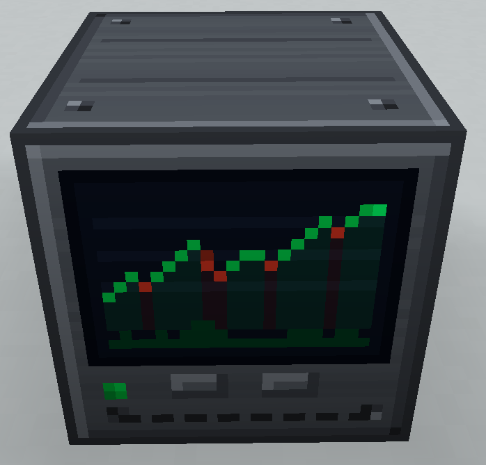
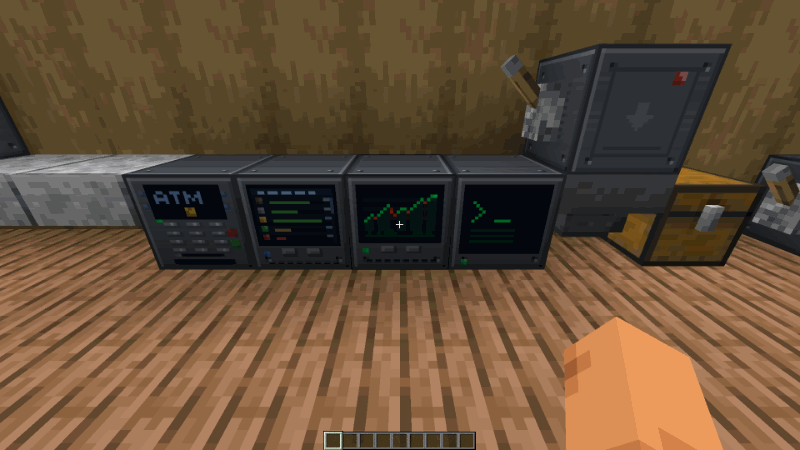
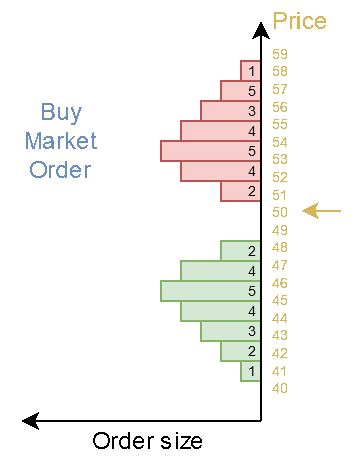
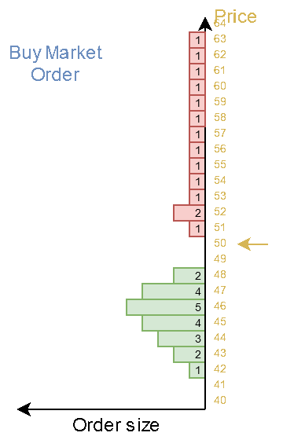
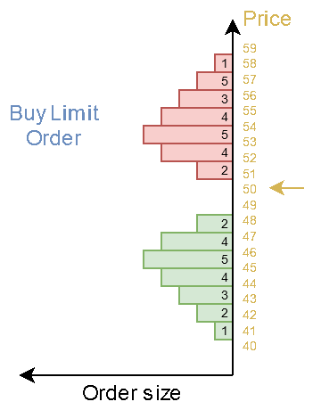
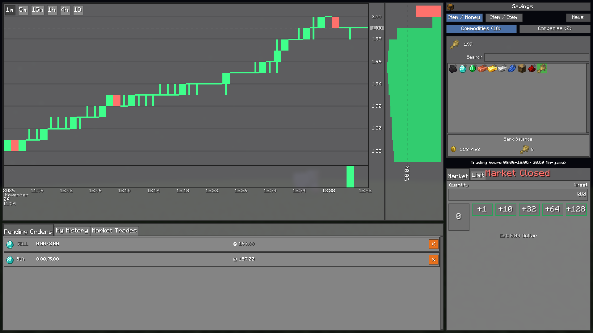

# Trading basics

On the stock market you buy and sell items for money. You don't hand items to another player. Instead you place an **order**, and the market matches it with someone who wants the opposite trade. This page shows you how to place your first orders and where the money and items come from.

## Before you start

You need three things:

- **A market for the item.** Only items with a market can be traded. The server admin creates the markets.
- **A bank account.** StockMarket has no wallet of its own. Every trade uses the money and items in your [BankSystem bank account](../banksystem/bank-accounts.md). Every player gets a personal account automatically.
- **A Stock Market Block** to open the trading screen. To make one, right-click a BankSystem **Terminal Block** with a **Trading Software** item. See [Blocks and recipes](blocks-and-recipes.md).

<figure markdown="span">
  { width="100" }
</figure>

## Where the money and items come from

All trades go through your bank account:

- **To buy**, you need money in the account. When the order fills, the items land in the same account.
- **To sell**, the items must be in the account first. Put them in at a [Bank Terminal](../banksystem/bank-terminal.md). When the order fills, the money lands in the account.
- When you place an order, the market **reserves** what it needs: the money for a buy, or the items for a sell. Reserved money and items are locked, so you can't spend them twice. If you cancel the order, they are unlocked again.
- To get bought items into your inventory, withdraw them at a Bank Terminal.

You can trade with any account where you have both the **deposit** and the **withdraw** permission, for example a shared account with friends. Click the account button at the top of the trading screen to pick one. Accounts you can't trade with are greyed out. The **Bank Balance** in the top bar shows what the chosen account holds.

!!! note "Frozen accounts"
    If an admin has frozen your bank account, you can't trade with it. You get the message *"This bank account is frozen by an admin and cannot trade"*.

## The trading screen

Right-click the Stock Market Block to open the trading screen.

<figure markdown="span">
  { width="600" }
</figure>

The screen has three parts:

- **The top bar** holds your favourite markets and the bank account selector. Click a market to switch to it, or use **Select Market** to browse all markets. The two mode buttons switch between **Item / Money** (buy and sell for money) and **Item / Item** (swap one item for another, see [Trading item for item](pair-trading.md)). The **News** button opens the [newspaper](newspaper.md).
- **The price chart** on the left shows the price history as candles, with the order book along its right edge. See [Price chart and order book](price-chart.md).
- **The trading panel** on the right has the order tabs **Market** and **Limit**, and below them the tabs **Pending Orders**, **My History** and **Market Trades**.

## Order types

There are two ways to buy or sell.

### Market order: trade now

A market order only needs a **Quantity**. It fills right away at the best prices that are on offer.

<figure markdown="span">
  { width="350" }
</figure>

- **Good:** the trade happens immediately.
- **Watch out:** a big order eats through several price levels. Your average price is then worse than the price you saw before the trade. On a market with little volume, a big order can move the price a lot.
- If there isn't enough volume on the other side, the order fills only partly. The rest is cancelled and refunded, and you get the message *"Market order only partly filled"*.

<figure markdown="span">
  { width="350" }
</figure>

### Limit order: trade at your price

A limit order needs a **Quantity** and a **Price**. It only fills at your price or better:

- A **buy** limit order pays at most your price. You usually place it below the current price and wait for the price to come down.
- A **sell** limit order gets at least your price. You usually place it above the current price.

<figure markdown="span">
  { width="350" }
</figure>

- **Good:** you never pay more, or get less, than you chose.
- **Watch out:** the order can take a long time to fill. If the price never reaches it, it never fills and stays open until you cancel it.

Limit orders that wait in the book are also what makes the market work: they are the volume that market orders trade against.

## Placing an order

1. Pick the market in the top bar.
2. Open the **Market** or **Limit** tab.
3. Type a **Quantity**, or use the **+1**, **+10**, **+32**, **+64** and **+128** buttons. For a limit order, also type a **Price**.
4. Check the estimated cost (**Est:**) in the panel.
5. Click **Buy** or **Sell**.

After an accepted order, the **Buy** and **Sell** buttons are greyed out for a short moment (half a second by default). This trade cooldown applies to all markets.

## Managing your orders

- **Pending Orders** lists your open limit orders. Each row has a button to cancel the order.
- Your limit orders also show as markers on the price chart. **Drag a marker** to change the order's price. A buy order only moves up if you have enough money for the higher price.
- **My History** lists your filled and cancelled orders.
- **Market Trades** lists the latest trades of everyone on this market.

## When a market is closed

A market can have opening hours, set by the server admin. The trading panel shows them, for example **Trading hours 08:00-18:00**, or **24h** for a market that never closes, together with the current time of the server's clock.

When you can't trade, a red label shows next to the **Market** and **Limit** tabs and the **Buy** and **Sell** buttons are greyed out:

- **Market Closed**: the market is outside its opening hours, or an admin closed it. Your open orders stay and fill when the market opens again. You can still cancel them, but you can't move them on the chart.
- **Under Maintenance**: an admin paused trading on this market. Your open orders on it are cancelled and refunded right away.

In **Item / Item** mode, both markets must be open. If one of them is closed, your exchange order waits until both are open.

<figure markdown="span">
  { width="600" }
</figure>

## Limits and messages

| Message | What it means | What to do |
|---|---|---|
| *Order too large: max N items per order* | Each market has a max order size, set by the admin. The quantity box never goes above it. | Split the trade into several orders. |
| *Trading too fast: wait N s* | You placed an order during the trade cooldown. | Wait a moment and try again. A rejected order doesn't restart the cooldown. |
| *Market is closed - outside trading hours* | The market has opening hours and is [closed right now](#when-a-market-is-closed). | Come back when it opens. |
| *Under Maintenance* (on the screen) | An admin has paused trading on this market. Your open orders on it were cancelled and refunded. | Wait until the admin ends the maintenance. |
| *No answer from the server - the order may have been placed* | The server didn't confirm the order in time, for example during lag. | Check **Pending Orders** and **My History** before you place it again. The order is never sent twice on its own. |

## Related pages

- [Price chart and order book](price-chart.md): why a price moves.
- [Trading item for item](pair-trading.md): the Item / Item mode.
- [Bank accounts](../banksystem/bank-accounts.md) and [Bank Terminal](../banksystem/bank-terminal.md): getting money and items in and out.
