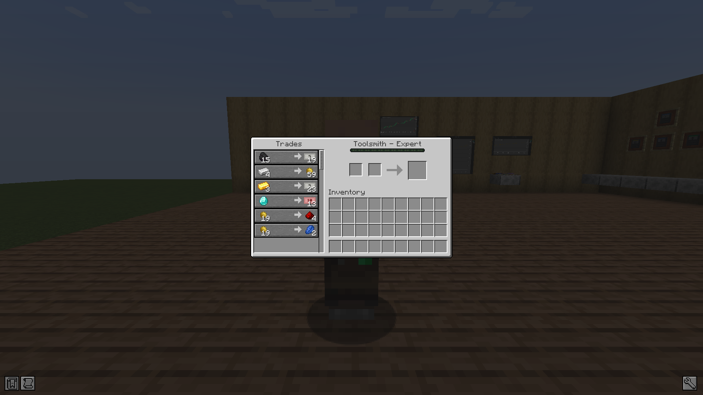

# Dorfbewohner-Handel { #villager-trading }

Mit StockMarket auf dem Server handeln Dorfbewohner für Geld statt für Smaragde. Ihre Preise folgen dem Aktienmarkt: Wenn der Marktpreis von Weizen steigt, zahlt dir ein Bauer mehr dafür. Diese Seite erklärt, was sich für dich ändert.

<figure markdown="span">
  { width="600" }
</figure>

## Welche Angebote sich ändern { #which-trades-change }

Ein Angebot eines Dorfbewohners wechselt auf Geld, wenn das Item, das er handelt, auf deinem Server einen Markt hat. Angebote für Items ohne Markt nutzen weiter Smaragde, außer dein Admin hat das geändert. Fahrende Händler funktionieren genauso.

## Mit Geld bezahlen { #paying-with-money }

Dorfbewohner nehmen Banknoten und Münzen aus BankSystem, nicht deinen Kontostand. Hebe an einem [Geldautomaten](../banksystem/money.md) Geld ab, bevor du handeln gehst.

- Lege eine beliebige Mischung aus Banknoten und Münzen in die Bezahlslots. Sie müssen zusammen nur den Preis ergeben. Zum Beispiel bezahlen zwei Scheine zu 10 Euro einen Handel über 20 Euro.
- Wenn du zu viel bezahlst, gibt dir der Dorfbewohner Wechselgeld.
- Wenn ein Dorfbewohner dir etwas abkauft, bekommst du Banknoten und Münzen. Zahle sie an einem Bank Terminal in die Bank ein, um damit zu handeln.

## Wie die Preise entstehen { #how-prices-are-set }

Die Preise der Dorfbewohner kommen vom Marktpreis, mit einer Marge:

- **Ein Dorfbewohner kauft** dir Items für weniger als den Marktpreis ab. Standardmäßig zahlt er 80% davon.
- **Ein Dorfbewohner verkauft** dir Items für mehr als den Marktpreis. Standardmäßig verlangt er 120% davon.

Der Aktienmarkt bringt dir also meist einen besseren Preis als ein Dorfbewohner. Dorfbewohner sind praktisch, wenn du weit weg von einem Aktienmarkt-Block bist oder wenn auf dem Markt niemand deine Items will.

Die Preise ändern sich nicht mit jedem Handel am Markt. Der Server aktualisiert sie standardmäßig alle 20 Minuten.

!!! note "Handel mit Dorfbewohnern bewegt den Markt nicht"
    Der Handel mit einem Dorfbewohner platziert nie eine Order am Aktienmarkt. Er ändert keinen Marktpreis.

Rabatte durch das Heilen eines Zombiedorfbewohners oder durch den Effekt „Held des Dorfes“ gelten weiterhin, bis zu 20% Nachlass.

## Verwandte Seiten { #related-pages }

- [Geld und der Geldautomat](../banksystem/money.md): Banknoten und Münzen bekommen.
- [Grundlagen des Handels](trading.md): stattdessen am Markt verkaufen.
- [So arbeiten die beiden Mods zusammen](../together.md): die Bank, der Markt und die Dorfbewohner in einem Bild.
