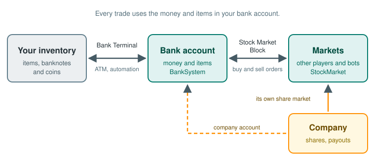
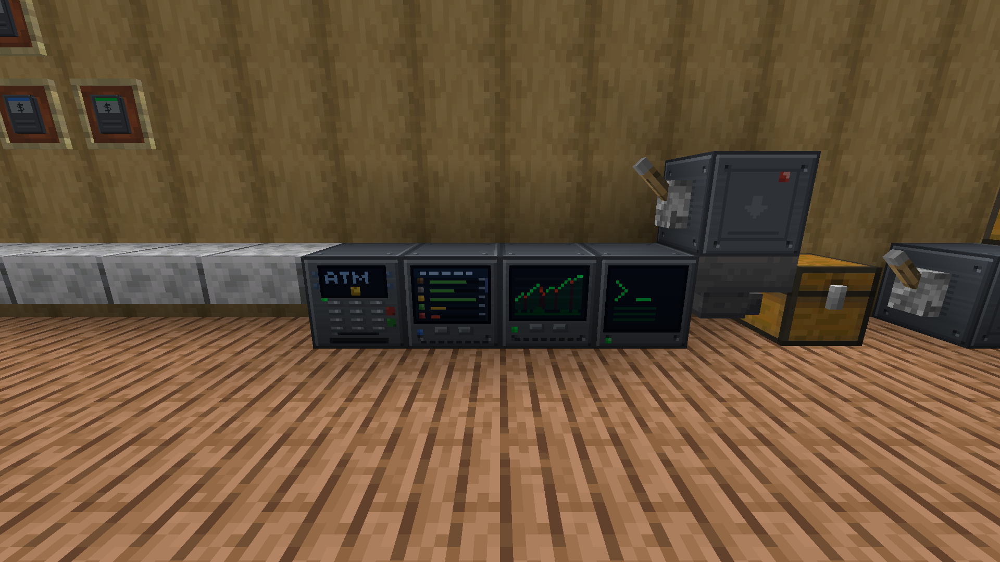

# So arbeiten die beiden Mods zusammen { #how-the-two-mods-work-together }

BankSystem ist die Bank: Sie verwahrt dein Geld und deine Items. StockMarket ist der Markt: Er handelt sie. Die beiden Mods teilen sich ein Konto, also fließt alles, was du am Markt kaufst oder verkaufst, in deine Bank hinein und aus ihr heraus. Diese Seite erklärt, wie sie zusammenhängen.

<figure markdown="span">
  { width="600" }
</figure>

## Ein Block, mehrere Aufgaben { #one-block-several-jobs }

Der **Terminal Block** aus BankSystem ist die Grundlage für alle Bank- und Marktblöcke. Klicke ihn mit einem Software-Item mit Rechts an, und er wird zu einem anderen Block:

| Software | Der Terminal Block wird zum | Was du dort machst |
|---|---|---|
| **Banking Software** | **Bank Terminal Block** | Items zwischen deinem Inventar und der Bank bewegen. Siehe [Bank Terminal](banksystem/bank-terminal.md). |
| **Bankomat Software** | **Geldautomat** | Geld als Banknoten und Münzen abheben. Siehe [Geld und der Geldautomat](banksystem/money.md). |
| **Handels Software** (StockMarket) | **Aktienmarkt-Block** | Am Markt kaufen und verkaufen. Siehe [Grundlagen des Handels](stockmarket/trading.md). |
| **Leere Software** | wieder **Terminal Block** | Nichts: Damit setzt du einen Block zurück. |

Die Software wird nicht verbraucht. Du kannst jeden dieser Blöcke jederzeit umprogrammieren, zum Beispiel aus einem Bank Terminal einen Aktienmarkt-Block machen.

<figure markdown="span">
  { width="600" }
</figure>

## Dein Bankkonto ist deine Handelsgeldbörse { #your-bank-account-is-your-trading-wallet }

StockMarket hat kein eigenes Geld. Jeder Handel nutzt ein [BankSystem-Bankkonto](banksystem/bank-accounts.md):

- **Kaufen** nimmt Geld vom Konto. Die gekauften Items landen auf demselben Konto, nicht in deinem Inventar.
- **Verkaufen** nimmt Items vom Konto. Bring sie also zuerst an einem Bank Terminal in die Bank. Das Geld landet auf dem Konto.
- **Solange eine Order offen ist**, reserviert der Markt, was sie braucht: das Geld für einen Kauf oder die Items für einen Verkauf. Die Bank führt sie als reserviert, du kannst sie also nicht doppelt ausgeben oder abheben. Wenn die Order ausgeführt ist oder du sie stornierst, wird die Reservierung aufgehoben.
- **Um Gekauftes zu behalten**, hol es an einem Bank Terminal heraus.

Du kannst mit jedem Konto handeln, auf dem du **Erlaubt einzuzahlen** und **Erlaubt abzuheben** hast. Dazu gehören gemeinsame Konten, zum Beispiel eines, das du mit Freunden führst. Wähle das Konto mit dem Kontoknopf oben im Handelsbildschirm.

!!! note "Eingefrorene Konten"
    Ein Admin kann ein Bankkonto einfrieren. Seine offenen Orders werden storniert, und es kann nicht handeln, bis der Admin es wieder auftaut.

Jedes Item, das einen Markt hat, kann in die Bank, auch wenn der Admin es nie von Hand erlaubt hat.

## Unternehmensaktien werden zu Märkten { #company-shares-become-markets }

In BankSystem kannst du ein Unternehmen gründen und seine Aktien an der **Aktien-Prägestation** prägen. Der Gründer kann dann im Tab **Markt** des Unternehmens einen Markt für diese Aktien erstellen. Ab diesem Moment werden die Aktien wie jedes andere Item gehandelt. Andere Spieler finden sie unter **Unternehmen**, wenn sie einen Markt auswählen.

Mehr dazu:

- Für Gründer: [Dein Unternehmen am Aktienmarkt](banksystem/company-market.md).
- Für Händler: [Unternehmensaktien handeln](stockmarket/company-shares.md).

## Dorfbewohner zahlen mit Geld { #villagers-pay-in-money }

Mit StockMarket können Dorfbewohner für Geld statt für Smaragde handeln. Ihre Preise folgen dem Marktpreis des Items. Du bezahlst mit Banknoten und Münzen, und der Dorfbewohner gibt dir Wechselgeld. Dein Server-Admin entscheidet, ob das eingeschaltet ist. Siehe [Dorfbewohner-Handel](stockmarket/villager-trading.md).

## Dein Gesamtvermögen richtet sich nach Marktpreisen { #your-total-wealth-uses-market-prices }

Der Kontoverlauf im Bank Terminal (Knopf **History**) zeigt eine goldene Linie **Total Wealth**. Sie zählt das Geld und die Items auf dem Konto zusammen, reservierte eingeschlossen, und rechnet jedes Item mit seinem aktuellen Marktpreis. Items ohne Markt zählen als null. Wenn sich die Preise ändern, ändert sich auch dein Gesamtvermögen, selbst wenn du nicht handelst.

## Verwandte Seiten { #related-pages }

- [Erste Schritte](getting-started.md): die erste Einzahlung und der erste Handel, Schritt für Schritt.
- [Bankkonten](banksystem/bank-accounts.md): gemeinsame Konten und ihre Rechte.
- [Grundlagen des Handels](stockmarket/trading.md): wie Orders dein Geld reservieren und verwenden.
