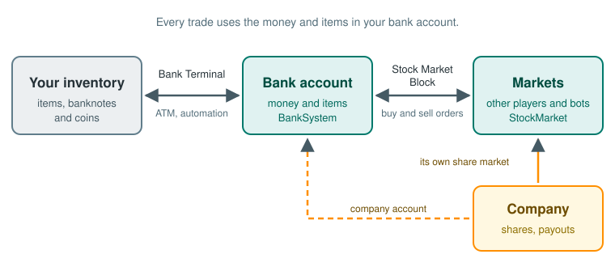
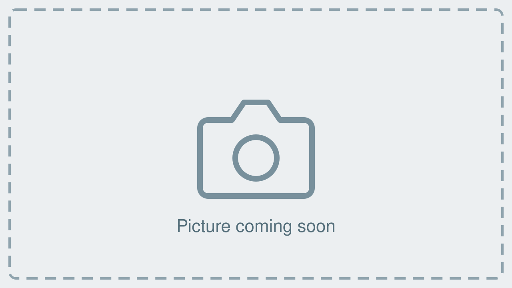

# How the two mods work together

!!! info "Not written yet"
    This page will cover: The Terminal Block family (Bank Terminal, ATM and Stock Market Block are one block with different software); your bank account as your trading wallet (which accounts can trade, money and items reserved while an order is open, frozen accounts); company shares as markets; villagers paying in money; total wealth from market prices.

<!-- Sources for the rewrite:
  - SM:README.md#getting-started
  - SM:code screen/TradeScreen.java (account selector), networking/request/CreateOrderRequest.java
  - BS:code minecraft/block/custom/TerminalBlock.java, integration/stockmarket/StockMarketBridge.java
-->

<figure markdown="span">
  { width="600" }
</figure>

<figure markdown="span">
  { width="600" }
  <figcaption>Image missing: shared/terminal-family.png</figcaption>
</figure>
